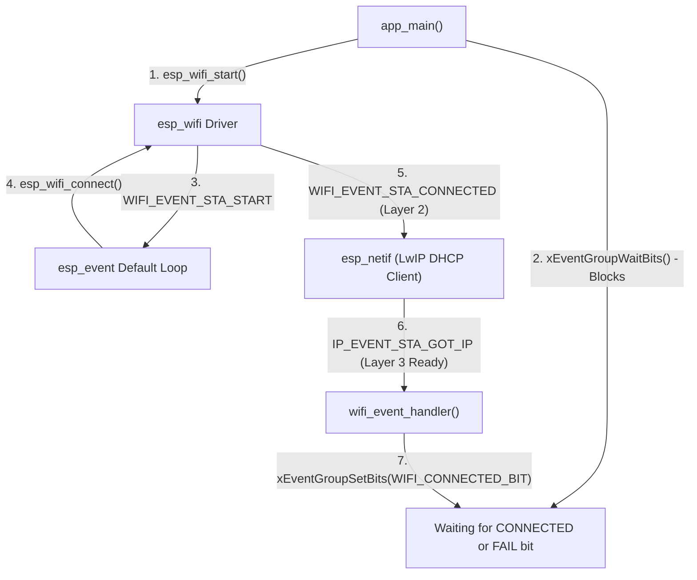

# Hands-On Lab Guide (Session 1): ESP32 Wi-Fi Protocol, HTTP & REST APIs

**Duration:** 3 Hours (180 Minutes)  
**Target Framework:** ESP-IDF (v5.x)  
**Next Session Preview:** Session 2 will use the `device_token` and `assigned_mqtt_topic` obtained in Module 4 of this lab to publish live sensor data over MQTT and MQTT over TLS (`mqtts://`).

---

## 3-Hour Lab Schedule & Pacing

| Time | Module | Topic | Deliverable / Checkpoint |
| :--- | :--- | :--- | :--- |
| **0:00 – 0:40** *(40m)* | **Module 1** | **802.11 Wi-Fi Fundamentals & Active Scanning** | Students run `wifi_scan_networks()` and inspect 2.4 GHz channels, RSSI (dBm), and WPA2/WPA3 security modes in the serial monitor. |
| **0:40 – 1:25** *(45m)* | **Module 2** | **Station Association, LwIP Netif & FreeRTOS Event Groups** | Students connect their ESP32 to the classroom AP, trace the difference between `WIFI_EVENT_STA_CONNECTED` and `IP_EVENT_STA_GOT_IP`, and print their IP & MAC. |
| **1:25 – 1:35** *(10m)* | *Break* | — | — |
| **1:35 – 2:15** *(40m)* | **Module 3** | **HTTP Client & Consuming REST APIs (`GET` + `cJSON`)** | Students query a live weather REST API, reassemble chunked HTTP data events, parse nested JSON objects, and verify zero heap leaks. |
| **2:15 – 3:00** *(45m)* | **Module 4** | **IoT Device Enrollment via FastAPI (`POST` + JSON Body)** | Students serialize device telemetry into JSON, send an HTTP `POST` to the FastAPI Enrollment Server, and appear on the live class roster (`GET /api/v1/devices`). |

---

## Module 1: 802.11 Wi-Fi Protocol Fundamentals & Active Scanning (40 mins)

### 1. Scaffolded Concept Explanation

Before an IoT device can send a single byte of application data, it must establish a physical and data-link connection (OSI Layers 1 & 2) using the **IEEE 802.11** standard:

1. **2.4 GHz Band & Channels:** Standard ESP32 chips operate in the 2.4 GHz ISM band (Channels 1–13). Because each channel is 20 MHz wide and channels are spaced only 5 MHz apart, **only Channels 1, 6, and 11 are non-overlapping**.
2. **Passive vs. Active Scanning:**
   - **Passive Scan:** The ESP32 tunes its radio to each channel and listens for **Beacon frames** broadcast by Access Points (APs) every ~100 ms.
   - **Active Scan (ESP-IDF Default):** The ESP32 actively transmits a **Probe Request** frame on each channel and measures the **Probe Response** from nearby APs.
3. **RSSI (Received Signal Strength Indicator):** Measured in **dBm** (decibels relative to 1 milliwatt). Because it is a logarithmic scale of attenuation, values are negative:
   - `-30 to -60 dBm`: Excellent signal
   - `-61 to -75 dBm`: Good/Reliable for HTTP & MQTT
   - `-80 dBm or lower`: Weak; expect packet retries and TCP timeouts
4. **Authentication Modes:** Tells the station what cryptographic handshake is required (`WIFI_AUTH_OPEN`, `WIFI_AUTH_WPA2_PSK`, `WIFI_AUTH_WPA3_PSK`).

### 2. Code Walkthrough (`wifi_scan_networks` in [main/wifi_sta.c](file:///home/ibeto87/Wifi_MQTT/main/wifi_sta.c))

```c
/* Start a blocking active scan across all channels (second parameter = true) */
esp_wifi_scan_start(NULL, true);

/* Retrieve how many APs were discovered and copy the top records */
uint16_t number = DEFAULT_SCAN_LIST_SIZE;
wifi_ap_record_t ap_info[DEFAULT_SCAN_LIST_SIZE];
uint16_t ap_count = 0;

ESP_ERROR_CHECK(esp_wifi_scan_get_ap_num(&ap_count));
ESP_ERROR_CHECK(esp_wifi_scan_get_ap_records(&number, ap_info));
```

### 3. Hands-On Exercise 1
1. Open [main/main.c](file:///home/ibeto87/Wifi_MQTT/main/main.c) and set only `LAB_ENABLE_STEP_1_SCAN` to `1` (set Steps 2–4 to `0`).
2. Build, flash, and monitor: `idf.py build flash monitor`.
3. **Lab Question:** Which 2.4 GHz channel is the most crowded in the classroom right now, and what is the RSSI (in dBm) of the classroom lab router from your desk?

---

## Module 2: Wi-Fi Station Association, LwIP & FreeRTOS Event Groups (45 mins)

### 1. Scaffolded Concept Explanation

A common beginner mistake in embedded systems is trying to open a TCP socket immediately after calling `esp_wifi_connect()`. Why does that fail?

1. **802.11 State Machine vs. TCP/IP Stack:**
   - Calling `esp_wifi_connect()` starts the **Layer-2 (802.11)** handshake: *Probe -> Authentication -> Association -> WPA2 4-Way Handshake*. When this finishes, the Wi-Fi driver posts `WIFI_EVENT_STA_CONNECTED`.
   - **You still do not have an IP address!**
   - The `esp_netif` bridge sees `WIFI_EVENT_STA_CONNECTED` and automatically triggers the **LwIP DHCP Client** (*DHCP Discover -> Offer -> Request -> ACK*).
   - Only when the router assigns an IPv4 address does `esp_netif` post `IP_EVENT_STA_GOT_IP`.
2. **Why NVS (`nvs_flash_init`) is Required for Wi-Fi:**
   - The ESP32 Wi-Fi driver stores RF calibration parameters (PHY init data) and optional persistent station credentials in a dedicated flash partition managed by Non-Volatile Storage (NVS).
3. **Synchronizing Asynchronous Events with `EventGroupHandle_t`:**
   - Instead of polling with `vTaskDelay()` loops (which wastes CPU or adds latency), `app_main()` calls `xEventGroupWaitBits()`, putting the main task to sleep with **zero CPU overhead** until the event handler sets either `WIFI_CONNECTED_BIT` (`BIT0`) or `WIFI_FAIL_BIT` (`BIT1`).



**ASCII Sequence Reference (for plain-text viewers):**
```text
app_main()          esp_event Loop       esp_wifi Driver      esp_netif (LwIP DHCP)
    |                      |                    |                       |
    |--- esp_wifi_start() --------------------->|                       |
    |--- xEventGroupWaitBits() [Blocks]         |                       |
    |                      |<-- STA_START ------|                       |
    |                      |--- esp_wifi_connect()                      |
    |                      |<-- STA_CONNECTED --|                       |
    |                      |--- Triggers DHCP Discover/Offer/Req/ACK -->|
    |                      |<-- IP_EVENT_STA_GOT_IP --------------------|
    |<-- SetBits(CONNECTED)|                    |                       |
 [Unblocks!]               |                    |                       |
```

### 2. Code Walkthrough (`wifi_event_handler` in [main/wifi_sta.c](file:///home/ibeto87/Wifi_MQTT/main/wifi_sta.c))

Inspect how [main/wifi_sta.c](file:///home/ibeto87/Wifi_MQTT/main/wifi_sta.c) separates Layer-2 connection retries from Layer-3 IP readiness:
- On `WIFI_EVENT_STA_DISCONNECTED`, it checks `disconn->reason` and retries up to `WIFI_MAX_RETRY` (5 times) before setting `WIFI_FAIL_BIT`.
- On `IP_EVENT_STA_GOT_IP`, it prints the IP, netmask, and gateway using the `IPSTR` / `IP2STR()` macros and sets `WIFI_CONNECTED_BIT`.

### 3. Hands-On Exercise 2
1. In [main/main.c](file:///home/ibeto87/Wifi_MQTT/main/main.c), enter your classroom SSID and password in `LAB_WIFI_SSID` and `LAB_WIFI_PASS`.
2. Enable `LAB_ENABLE_STEP_2_CONNECT` (`1`) while keeping Steps 3 & 4 disabled (`0`).
3. **Fault-Injection Experiment:** Intentionally type a wrong password first, flash the board, and observe the `Reason Code` logged on `WIFI_EVENT_STA_DISCONNECTED` as it retries 5 times and hits `WIFI_FAIL_BIT`. Then fix the password and verify you get an IPv4 address.

---

## Module 3: HTTP Client & Consuming REST APIs (`GET` + `cJSON`) (40 mins)

### 1. Scaffolded Concept Explanation

Once `IP_EVENT_STA_GOT_IP` has fired, the ESP32 can communicate with any REST API on the local network or the internet.

1. **Anatomy of an HTTP Request & Response:**
   - **Method (Verb):** `GET` (retrieve resource), `POST` (create/submit data), `PUT`/`PATCH` (update), `DELETE`.
   - **URI:** `http://<host>:<port>/<path>?<query_params>`
   - **Headers:** Key-value metadata such as `Content-Type: application/json`, `User-Agent`, and `Content-Length`.
   - **Status Codes:**
     - `200 OK` / `201 Created`: Success
     - `400 Bad Request` / `401 Unauthorized` / `404 Not Found` / `422 Unprocessable Entity`: Client error
     - `500 Internal Server Error`: Server error
2. **Why `HTTP_EVENT_ON_DATA` Requires an Accumulator Buffer:**
   - Underlying TCP sockets deliver data in **packets/segments** (often 512–1460 bytes at a time).
   - If an API returns a 2 KB JSON response, `HTTP_EVENT_ON_DATA` will be invoked **multiple times**—once per arriving TCP chunk!
   - If you call `cJSON_Parse()` inside `HTTP_EVENT_ON_DATA`, it will fail on partial JSON fragments. Instead, we append each chunk into `http_resp_buf_t` and parse only after `esp_http_client_perform()` finishes.
3. **Safe JSON Parsing with `cJSON`:**
   - `cJSON_Parse(buffer)` allocates a linked tree of `cJSON` structs on the heap.
   - Always validate types using `cJSON_IsObject()`, `cJSON_IsNumber()`, or `cJSON_IsString()` before dereferencing pointers (`->valuedouble`, `->valuestring`).
   - **Crucial:** Call `cJSON_Delete(root)` once before returning to free the entire tree!

### 2. Hands-On Exercise 3
1. In [main/main.c](file:///home/ibeto87/Wifi_MQTT/main/main.c), set `LAB_ENABLE_STEP_3_GET_API` to `1`.
2. Notice the default `WEATHER_API_URL` uses **Open-Meteo** (`http://api.open-meteo.com/v1/forecast?latitude=4.61&longitude=-74.08&current_weather=true`), which requires **zero API keys**.
   - *(Optional)* If you have an **OpenWeatherMap** key, replace `WEATHER_API_URL` with the OpenWeatherMap URL shown in the comments of [main/main.c](file:///home/ibeto87/Wifi_MQTT/main/main.c)—`parse_weather_json()` in [main/http_rest.c](file:///home/ibeto87/Wifi_MQTT/main/http_rest.c) supports both schemas automatically!
3. Change the `latitude` and `longitude` query parameters in `WEATHER_API_URL` to your city, flash the ESP32, and verify the parsed temperature and wind speed in the serial monitor.

---

## Module 4: IoT Device Enrollment via FastAPI (`POST` + JSON Body) (45 mins)

### 1. Scaffolded Concept Explanation

In real-world IoT deployments, devices aren't hardcoded with individual MQTT topics or tokens at the factory. Instead, on first boot, a device performs **Device Provisioning / Enrollment**:
1. The device reads its factory-unique hardware MAC address (`esp_read_mac`) and current link quality (`wifi_get_rssi`).
2. It serializes a JSON object using `cJSON_CreateObject()` and `cJSON_PrintUnformatted()`.
3. It sets the HTTP header `Content-Type: application/json` (if omitted, strict frameworks like FastAPI will reject the body!) and sends an **HTTP `POST`** request to the provisioning server.
4. The FastAPI server validates the payload with **Pydantic**, registers the device, and returns a JSON response containing the device's `device_token` and `assigned_mqtt_topic` (e.g., `lab/devices/AABBCCDDEEFF/telemetry`).

### 2. Running the FastAPI Backend ([server/enrollment_server.py](file:///home/ibeto87/Wifi_MQTT/server/enrollment_server.py))

On the instructor's computer (or each student's laptop on the same LAN):

```bash
# 1. Install FastAPI and Uvicorn
pip install fastapi uvicorn pydantic

# 2. Start the server listening on all network interfaces (0.0.0.0) port 8000
cd server
uvicorn enrollment_server:app --host 0.0.0.0 --port 8000 --reload
```

You can interactively explore the auto-generated OpenAPI (Swagger) documentation in your browser at:
- **Interactive Swagger UI:** `http://<INSTRUCTOR_IP>:8000/docs`
- **Live Enrolled Class Roster:** `http://<INSTRUCTOR_IP>:8000/api/v1/devices`

### 3. Hands-On Exercise 4
1. In [main/main.c](file:///home/ibeto87/Wifi_MQTT/main/main.c):
   - Set `LAB_STUDENT_ID` to your name or team name.
   - Update `FASTAPI_SERVER_URL` with the IP address of the machine running [server/enrollment_server.py](file:///home/ibeto87/Wifi_MQTT/server/enrollment_server.py).
   - Set `LAB_ENABLE_STEP_4_POST_API` to `1`.
2. Build, flash, and monitor your ESP32.
3. Verify that your ESP32 prints `HTTP POST Status = 201` along with your `Device Token` and `Assigned Topic`.
4. **Bonus Challenge (Schema Validation):** In [main/http_rest.c](file:///home/ibeto87/Wifi_MQTT/main/http_rest.c), comment out the line `cJSON_AddNumberToObject(req_root, "rssi_dbm", current_rssi);` and re-flash. What HTTP status code does FastAPI return when a required field is missing (`422 Unprocessable Entity`), and what does the error JSON look like?
